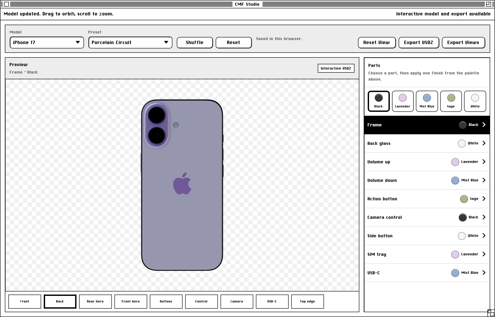
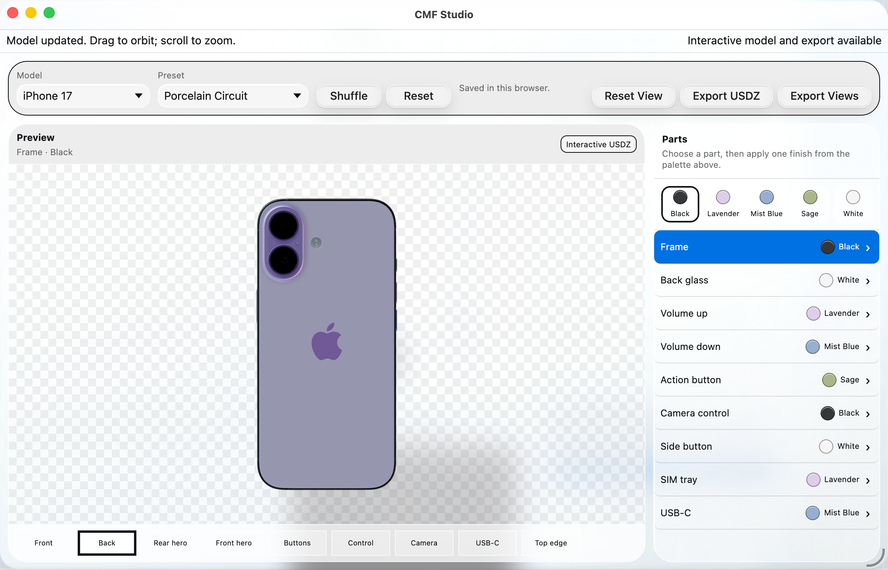

# CMF Studio

A colour, material and finish workbench for real devices. Pick a phone or the
laptop, choose a part, paint it with one of the finishes the manufacturer
actually ships for that device, and look at the result as a live 3D model:
orbit it, jump to named views, open the laptop's lid or fold the folding phone.
Export the finished device as a USDZ for Quick Look and AR, the named views as
PNGs, and the fold as a video.

## Screenshots

Captured running inside the AI System 6 desk: Classic on the left, Liquid Glass on the right.

<p> </p>

It is a workbench recipe, not a shipped colourway: every finish is real, the
combination is yours.

It runs on its own page and as a window of the AI System 6 desk, where it talks
to the desk through the app kit's bridge (`public/ais6-bridge.js`).

## Run

```sh
npm install
npm run dev
```

Then open the address Vite prints. `npm run build` writes the page to `dist/`;
`npm run preview` serves that build.

## Check

```sh
npm run check      # typecheck, lint, unit tests, build
npm run test:e2e   # Playwright against `vite preview` of the build
```

`CONTRACTS.md` maps every assertion of the desk's former CMF contracts to the
test, type or desk contract that holds it now.

## What a host provides

On its own page the app keeps its recipes in the browser and saves files as
downloads. Inside a desk it asks the host for:

| Bridge call | Used for |
| --- | --- |
| `state.get` / `state.set` | each device's saved recipe |
| `files.export` | USDZ, PNG and WebM files |
| `service.request` `cmf.capabilities` | whether the host can build a USDZ on its server |
| `service.request` `cmf.exportUsdz` | that server build, used only when the model file cannot be fetched |
| `menu.command`, `menu.state` | the File, Recipe and View menus, with the current view checked |
| `lifecycle.suspend` / `resume` / `dispose` | stopping the render loop while the window is away |

USDZ export runs in the browser from the shipped model. The server path
(`cmf.exportUsdz`) is a fallback that needs a host desk offering that service;
without one, and without the model file, export is disabled.

## Layout

| Path | What it holds |
| --- | --- |
| `src/model/` | the device catalogue, recipes, look-ups |
| `src/motion/` | the laptop hinge and fold easing |
| `src/render/` | the three.js studio, materials, framing, the folding phone's scene frame |
| `src/export/` | USDZ repackaging and file names |
| `src/bridge/` | the typed bridge to the host |
| `src/app/` | the controller: state as signals, every action |
| `src/ui/` | Preact components |
| `src/styles/` | the stylesheet, on the kit's tokens |
| `src/strings/` | English and Chinese strings |
| `build/` | the two patches three's USD composer needs, applied at build time |
| `public/` | the manifest, the kit, the models and scenes |
| `tests/unit/`, `tests/e2e/` | Vitest and Playwright |

## Licence

Code: MIT (`LICENSE`). The device models, product scenes and lighting
environment under `public/assets/` are used with permission and are not under
MIT; `LICENSES.md` lists them.
